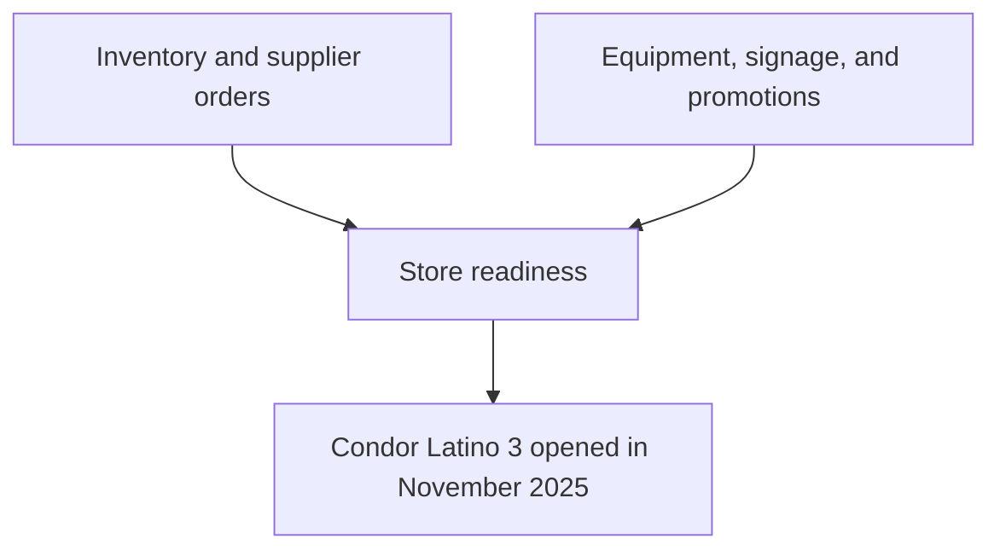

# Project 2: Condor Latino 3 Store Launch

**Organization:** Condor Latino Services  
**Opening:** November 2025  
**My role:** Retail operations and launch support

## The challenge

Opening another store requires getting multiple operational details ready at once, including inventory, suppliers, equipment, signage, and customer-facing information.

## What I did

- **Coordinated** inventory needs and supplier orders for the new location.
- **Helped prepare** retail equipment and store operations for opening.
- **Organized** signage and promotional materials for the business.
- **Supported** the team's work to make the store ready for customers.

## Results

**Condor Latino 3 opened in November 2025.** My contributions were part of the broader team effort to prepare the new location. I did not track a separate sales or cost-saving metric for my portion of the work.

## Project workflow

*Illustrative opening checklist, not an internal business document.*

## What I learned

A new store can only open smoothly when small details are handled and everyone stays coordinated. Supplier communication and inventory organization are just as important as what customers see on opening day.

## Related skills

Inventory management · Vendor coordination · Retail operations · Store launch planning · Marketing and promotions

[Return to portfolio home](../README.md)
